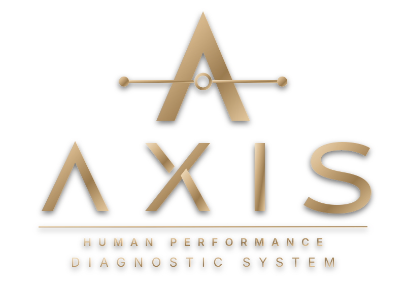

# AXIS HUMAN PERFORMANCE — Site Oficial & Plataforma 3D



Site institucional e vitrine tecnológica interativa da **AXIS HUMAN PERFORMANCE LTDA.** (`CNPJ 67.828.408/0001-27` — Maringá / PR), construído com **React 19**, **Three.js / React Three Fiber**, **GSAP ScrollTrigger** e **Tailwind CSS v4**.

---

## Visão Geral

A **AXIS** é uma empresa de inteligência e performance empresarial que integra:

$$\text{Pessoas} + \text{Estratégia} + \text{Processos} + \text{Tecnologia} = \text{Performance Empresarial}$$

### Lógica Operacional:
$$\text{Diagnosticar} \longrightarrow \text{Organizar} \longrightarrow \text{Executar} \longrightarrow \text{Medir} \longrightarrow \text{Melhorar} \longrightarrow \text{Escalar}$$

---

## Principais Funcionalidades Implementadas

- **Identidade Oficial Vetorizada (`SVG`)**: Símbolo com eixo orbital e tipografia `Λ X I S — HUMAN PERFORMANCE DIAGNOSTIC SYSTEM` em acabamento metálico *Champagne Gold*.
- **Tema Escuro & Claro (Dark / Light Mode)**: Alternador instantâneo no cabeçalho com persistência em `localStorage` e iluminação 3D adaptativa (`StudioLights`).
- **Responsividade Completa**: Layout otimizado para **Desktop**, **Tablet** e **Mobile** (com menu gaveta responsivo e controles 3D adaptados ao toque).
- **Experiência 3D Interativa (`Three.js`)**: Visualização em 360° da estação executiva rodando os 3 módulos do **AXIS Diagnostic System**:
  1. *Módulo 01 — Diagnóstico Humano & Comportamental* (Michele Mattos — CEO)
  2. *Módulo 02 — AXIS OS & Arquitetura de Processos* (Andriely — COO)
  3. *Módulo 03 — Cockpit Executivo & SaaS* (Pablo — CTO)
- **Modal de Diagnóstico de Maturidade Empresarial**: Qualificação de leads executivos com geração automática de protocolo para atendimento comercial via WhatsApp.

---

## Como Executar Localmente

```bash
# Instalar dependências
npm install

# Iniciar servidor de desenvolvimento
npm run dev

# Gerar build de produção otimizado
npm run build
```
